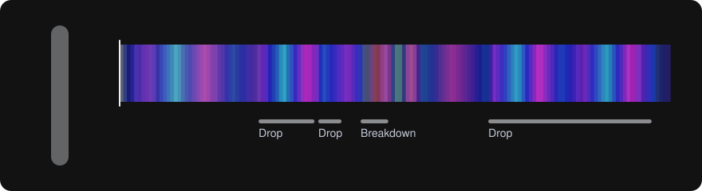
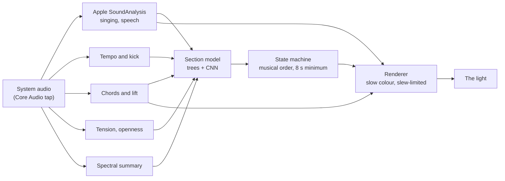
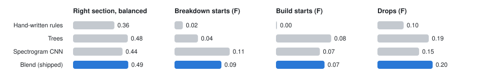
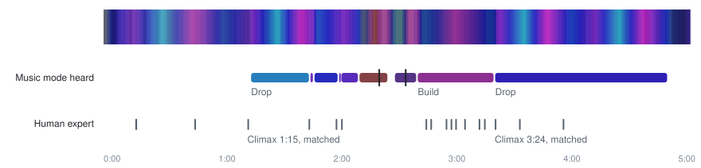
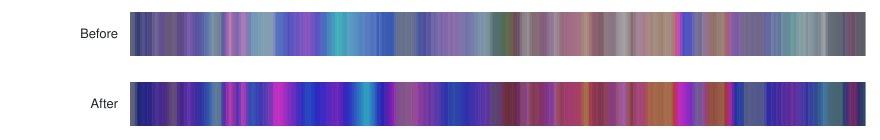
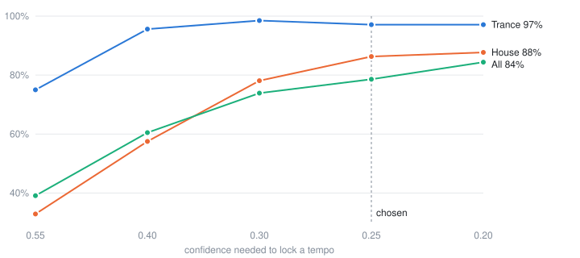

# Music mode: research, tuning and training

How music mode learned to follow house and trance: the research it rests on,
what real music taught it, the models, the datasets and how every number here
can be reproduced. No audio is in this repository. Public datasets are
downloaded to `~/datasets`; the owner's own recordings stay on their Mac.

<a href="https://jtannahill.github.io/amaran-mcp/">
<picture>
  <source media="(max-width: 600px)" srcset="hero-narrow.svg">
  
</picture>
</a>

*The light through a whole track, as music mode drives it. [Play it with sound](https://jtannahill.github.io/amaran-mcp/).*

## At a glance

| Part | What it is |
|---|---|
| **Listens with** | A Core Audio process tap (system audio, no microphone) and **Apple SoundAnalysis**, the on-device sound classifier, for singing versus speech |
| **Hears** | Tempo, kick in or out, chords and the minor-to-major lift, tension, openness, voice |
| **Decides sections with** | A 50/50 blend of **gradient-boosted trees** and a **spectrogram CNN**, trained on 402 Creative Commons EDM tracks |
| **Section accuracy** | 0.49 balanced on unseen tracks (hand-written rules 0.36) |
| **Runs** | numpy only at runtime, 13 ms once a second |
| **Tempo** | 97% right on trance, 85% on house (GiantSteps); searched from 100 to 160 BPM |
| **Weakest spot** | Finding breakdown starts: about one in ten within a few seconds |

Contents: [what it is for](#what-music-mode-is-for) ·
[how trance is built](#how-trance-is-built) ·
[in Armin's words](#in-armin-van-buurens-words) ·
[vocal trance at 138](#vocal-trance-at-138-bpm) ·
[what it hears](#what-music-mode-hears) ·
[the first real breakdown](#what-the-first-real-breakdown-taught) ·
[Apple's sound classifier](#voice-apples-on-device-sound-classifier) ·
[the section model](#sections-the-trained-model) ·
[live check](#live-check-the-whole-pipeline-on-36-tracks) ·
[the first marked session](#the-first-marked-session-miss-you) ·
[colour](#colour-trance-wants-saturation) ·
[tempo](#tempo-giantsteps) · [key](#key-beatport-edm-key) ·
[the demo](#the-demo-page) · [open questions](#open-questions) ·
[reproduce](#reproduce-everything)

## What music mode is for

One [amaran PT2c](https://amarancreators.com/pages/amaran-pt2c) tube at a desk,
following house and trance played on the Mac or AirPlayed from an iPhone:
continuous mixes such as [A State of Trance](https://www.astateoftrance.com/),
[Find Your Harmony](https://andrewrayel.net/fyh-radioshow/) and
[Future Sound of Egypt](https://futuresoundofegypt.com/). It should feel abstract and ethereal,
with no flashing and no pulse on every beat. The moment that matters most to
its owner is the breakdown, "when the chords lift and the vocal comes in",
where the light should bloom.

## How trance is built

- **A journey, not a loop.** Intro, theme, a long soft breakdown with the
  beats gone, a rebuild, the anthem, outro. Tracks run long so they can
  progress. ([Sound on Sound](https://www.soundonsound.com/techniques/secrets-house-trance))
- **The breakdown is the emotional peak, not a gap.** Pad chords, delay tails
  and the vocal come forward; uplifting trance stretches it and brings wash
  pads and chord layers up front. ([Sound on Sound](https://www.soundonsound.com/node/4914907),
  [Wikipedia: Uplifting trance](https://en.wikipedia.org/wiki/Uplifting_trance))
- **Harmony carries the feeling.** Long progressions, with the balance of
  major and minor setting euphoric versus melancholic.
  ([Wikipedia](https://en.wikipedia.org/wiki/Uplifting_trance))
- **A build piles up tension.** Risers, white-noise sweeps, snare rolls,
  filters opening, sometimes a key change up.
- **What can be measured.** Harmonic change from chroma; tension follows
  roughness and noisiness more than brightness
  ([Farbood and Price 2017](https://bpb-us-e1.wpmucdn.com/wp.nyu.edu/dist/f/11865/files/2020/08/Farbood_Price_2017.pdf));
  EDM-specific measures such as sub-bass ratio and sidechain pumping
  ([arXiv 2509.11474](https://arxiv.org/pdf/2509.11474)).

### In Armin van Buuren's words

What Armin van Buuren has said about building a trance track, in interviews
and in his MasterClass (chapter descriptions as listed on TheTVDB), with what
each point means for music mode.

| What he says (paraphrased) | Source | For music mode |
|---|---|---|
| A track grows from an eight-bar main theme over drums and bass into four to six sections, with automation so no two parts sound alike | [Sound on Sound, 2009](https://www.soundonsound.com/people/armin-van-buuren) | Count in 8-bar phrases; a section change lands on a phrase |
| A track takes the listener from tense breakdowns to high-energy drops; it is laid out as intro, breakdown and drop | MasterClass, "Arranging" and "Percussion and Arranging" ([TheTVDB](https://thetvdb.com/series/masterclass/episodes/7545308), [2](https://thetvdb.com/series/masterclass/episodes/7545309)) | Two different peaks: an emotional bloom in the breakdown, a kinetic opening at the drop |
| Big lead parts are written to carry the breakdown | MasterClass, "The Big Payoff" ([TheTVDB](https://thetvdb.com/series/masterclass/episodes/7545303)) | The breakdown is a planned peak, not a lull |
| If the drop does not work, the track does not work | MasterClass, "Building the Drop" ([TheTVDB](https://thetvdb.com/series/masterclass/episodes/7545310)) | The release must be caught on time; a late drop is the worst miss |
| Words make a track memorable, sung or a single sample | MasterClass, "Working With Lyrics and Vocals" ([TheTVDB](https://thetvdb.com/series/masterclass/episodes/7545311)) | The vocal is worth its own signal: Apple's singing class |
| Making a trance tune, he already knows which singers to book and which chords the breakdown will use | [Skiddle, 2017](https://www.skiddle.com/news/all/Armin-Van-Buuren-interview-A-State-Of-Trance/32493/) | Chord change and vocal entry are deliberate, repeatable events, so detecting them is reasonable |
| What sets trance apart is the euphoria and its melodies, drawn from classical music; euphoria is the rush people come for | [Oxford Student, 2013](https://www.oxfordstudent.com/2013/05/30/the-lord-of-the-trance/), [Beatportal](https://www.beatportal.com/articles/797170-beatportal-exclusive-armin-van-buuren-discusses-euphoria-and-the-future-of-dance-music) | The bloom answers the melody and harmony, not the beat |
| Trance works toward a climax; a set moves from about 122 or 125 up to 140 or 145 BPM | [Time Out Chicago, 2008](https://www.timeout.com/chicago/clubs/armin-van-buuren), [OC Weekly, 2013](https://www.ocweekly.com/?p=133489) | Tempo is searched across 100 to 160 BPM, never assumed to be 138 |
| Club rules hold tracks to about 128 to 140 BPM; "Mr Navigator" is a 138 track he plays in every set | [Deezer, 2019](https://newsroom-deezer.com/2019/11/armin-van-buuren-hid-a-secret-message-to-his-son-in-the-new-album-balance/) | 138 is a home, not a rule |
| He complained that everything had become about the drop and the breakdown, and would rather take people on a journey | [EDMTunes, 2013](https://www.edmtunes.com/?p=29382) | Grooves deserve colour too, not only the peaks |
| He makes quick edits of tracks for his sets, and A State of Trance is mixed and edited in Ableton Live; he skips the second breakdown at festivals | [Ableton](https://www.ableton.com/en/pages/artists/armin_van_buuren/), [The AU Review](https://www.theaureview.com/music/the-au-interview-armin-van-buuren-netherlands/) | Radio-show cuts are compressed (seen on the first marked session); a second breakdown cannot be counted on |
| A pop single becomes a club mix by extending and rearranging it | MasterClass, "Singles, Club Mixes, and Edits" ([TheTVDB](https://thetvdb.com/series/masterclass/episodes/7545315)) | Radio edit and extended mix are different maps of the same song: colours must come from the version that plays |

He gives no single answer to whether the breakdown or the drop is the peak:
his teaching treats the breakdown as the emotional payoff and the drop as the
make-or-break moment. Music mode treats them as two different peaks.

## Vocal trance at 138 BPM

The music this was built for is the euphoric, vocal end of trance: the sound
of Armin van Buuren's [A State of Trance](https://www.astateoftrance.com/),
Andrew Rayel's [Find Your Harmony](https://andrewrayel.net/fyh-radioshow/) and
[Aly & Fila](https://alyandfila.com/)'s [Future Sound of Egypt](https://futuresoundofegypt.com/). It has habits that broad EDM does not, and
each one shaped music mode.

| The music | What it means for music mode |
|---|---|
| **138 BPM, four to the floor.** A beat is 0.43 s, a bar 1.74 s, an 8-bar phrase 14 s, a 32-bar breakdown nearly a minute | The tempo tracker searches 100 to 150 BPM (no half-time 69 BPM confusion) and every timing rule counts in bars at the tempo it hears: a breakdown starts after 4 bars without the kick, stays pale for its first 2 bars, and a build needs 2 bars of rising tension. The model's 16 s window holds about one 8-bar phrase |
| **A rolling, offbeat bassline** between the kicks, sidechained to them | The bass never really stops, so "is the kick in" cannot be judged by bass level. It is judged by beat strength at the remembered tempo, and a model sure of a build or a drop can end an intro the kick test missed |
| **The breakdown is the point.** The kick goes, pads, piano and delay tails swell, and the vocal arrives, often a female voice drenched in reverb | Breakdowns get their own colour logic: pale first, then the chords. Blending in the CNN was chosen for breakdowns over builds. A reverb-washed vocal reads only 0.30 to 0.35 on Apple's singing class, lower than a dry voice, so the vocal boost needs scaling to it |
| **Euphoria is harmonic.** Minor-key progressions such as i, VII, VI, VII (the owner's ASOT breakdown is B flat minor, A flat, G flat, A flat) lift onto major chords at the emotional peaks | The bloom is tied to that lift, minor onto major and nothing else. Major onto major (A flat to G flat) would bloom on every chord change |
| **The build** stacks snare rolls, white-noise risers, filter sweeps and sometimes a key change up | Tension is measured from noisiness and onset density, which rise through a build, rather than from brightness |
| **The drop** brings the kick back under the supersaw anthem lead, the breakdown's melody at full size | A release needs a sharp jump in low-band onsets with strong pumping; a bass swell in the breakdown is not enough |
| **Continuous mixes.** Tracks blend for 16 or 32 bars, and the radio host talks over intros and outros | A section can last only so long and must follow musical order, and speech never blooms: the classifier separates a host from a singer |

### The names for the parts of a track

Music mode's section names were checked against how trance producers, teachers
and Armin van Buuren himself talk about a track:

| Music mode | In trance | Source |
|---|---|---|
| Intro | Intro, or mix-in: the sparse start a DJ blends over | [Wikipedia: Trance music](https://en.wikipedia.org/wiki/Trance_music) |
| Groove | The beat and bass coming in; courses also say "main section" or "verse" | Armin's MasterClass chapters "Creating A Groove" and "Adding Groove and Bass" ([TheTVDB](https://thetvdb.com/series/masterclass/seasons/official/31)) |
| Breakdown | The breakdown, with a first and a second one; the "hands in the air" moment | [Sound on Sound](https://www.soundonsound.com/techniques/secrets-house-trance); Armin on skipping "the second breakdown" at festivals ([The AU Review](https://www.theaureview.com/music/the-au-interview-armin-van-buuren-netherlands/)) |
| Build | Build-up: snare rolls, risers and uplifters | [Wikipedia](https://en.wikipedia.org/wiki/Trance_music), [Attack Magazine](https://www.attackmagazine.com/technique/the-breakdown/what-is-the-recipe-for-an-effective-breakdown/) |
| Drop (internally "climax") | DJs and Armin say drop; teachers and Wikipedia say climax | Armin's MasterClass chapter "Building the Drop" |
| Release | "Build-up and release": the kick coming back | [Wikipedia](https://en.wikipedia.org/wiki/Trance_music) |
| Lift | Music mode's own word for minor chords moving onto major in a breakdown; no source uses it as a name, though uplifting trance's reliance on major chords is documented | [Wikipedia: Uplifting trance](https://en.wikipedia.org/wiki/Uplifting_trance) |
| (none yet) | Outro, or mix-out | [Wikipedia](https://en.wikipedia.org/wiki/Trance_music) |

Two changes follow: breakdowns are numbered (first, second) where they are
shown, and an outro is worth adding; neither SSME nor the rules mark one yet.
Phrasing works in blocks of 4, 8, 16 or 32 bars, and DJs mix on the phrase.
138 BPM is the euphoric end of the genre's 135 to 140: Armin's label
[Who's Afraid Of 138?!](https://www.edmtunes.com/2013/07/armin-van-buuren-to-launch-whos-afraid-of-138-record-label/)
began as a joke on A State of Trance about tempos dropping.

### What that means for the training data

SSME, the only large set with expert-marked drops, builds and breaks, is
broad EDM from SoundCloud: electro house, dubstep, drum and bass and some
progressive trance, at many tempos. Its "drop" is often a dubstep or electro
drop, and its breaks are shorter and less harmonic than a trance breakdown.
That is why the model is weakest at trance breakdown starts (about one in ten)
while the GiantSteps trance subset shows the tempo side is already strong (97%).
The plan follows from it:

- **Train on the genre.** The background listener records the owner's own
  sessions (ASOT, Find Your Harmony, FSOE) with their marks: breakdown, lift,
  vocal, build, drop. Those train a local model that stays on their Mac, and
  the published model keeps to Creative Commons data.
- **Mark the moments that matter.** A mark of "lift" or "vocal" in a
  breakdown is exactly the label SSME lacks.
- **Score on trance separately.** Broad-EDM numbers hide trance-specific
  failures; the owner's sessions become the trance test set.

## What music mode hears



| Reading | How | Module |
|---|---|---|
| Audio | Core Audio process tap on the system output, mono float PCM to the analyser | `music/systemtap.swift` |
| Voice | Apple SoundAnalysis: singing, choir, speech, rapping, crowd, twice a second | `music/systemtap.swift`, `music/timbre.py` |
| Tempo, bars, 8-bar phrases | Kick-band onset autocorrelation, locked beat grid | `music/tempo.py` |
| Kick in or out, right now | Beat strength over the last 2 s at the remembered tempo | `music/tempo.py` |
| Chord, major/minor balance, lift | 12-bin chroma matched to 24 triads | `music/harmony.py` |
| Tension, openness | Noisiness and high band, onset density, spectral centroid | `music/timbre.py` |
| Spectral summary | 8 bands, flux, flatness, centroid | `music/spectral.py` |
| Sections | The trained blend, inside a state machine that keeps musical order | `music/sections.py`, `music/analysis.py` |
| Colour | Sections, chords and voice to one slow colour, slew-limited | `music/render.py` |

## What the first real breakdown taught

A 3-minute clip of an ASOT breakdown (B flat minor, A flat, G flat, A flat),
recorded locally on 2026-10-26 and replayed with `amaran-mcp music-replay`.

| Finding | Evidence | Change |
|---|---|---|
| The breakdown kept its sub-bass, so a kick judged by bass level never left | Bass stayed at about 0.8 of its groove level | Kick presence from beat strength over the last 2 s at the remembered tempo: above 0.99 in the groove, below 0.12 in the breakdown, switching at 1:30 exactly as heard |
| An 8 s tempo window is too slow to time a release | 6 to 9 s to recover | A release is a sharp jump in low-band onsets (last 0.5 s against the 8 s before) with strong pumping, or a confirmed kick |
| A bass swell in the breakdown looked like a release | Onset jump 2.4, pumping 0.31 | A release needs a jump of 3 and pumping of 0.45 |
| Every chord change onto major counted as a lift | A flat to G flat would bloom on every chord | Lifts are minor to major only |
| The first vocal estimate read high through the groove | 0.3 to 0.9 everywhere | Replaced by Apple's sound classifier, below |

After tuning, the breakdown is found at 1:36 (the kick left at about 1:30; the
rule waits 4 bars), and the light blooms each time the progression lifts from
B flat minor to A flat, which the owner confirmed is right.

## Voice: Apple's on-device sound classifier

macOS SoundAnalysis ships a built-in classifier with 303 classes, among them
speech, singing, choir singing, rapping, synthesizer, bass drum, crowd and
applause. The capture helper runs it on the same audio it hands the analyser,
on the Mac, with no network. Music mode turns it into one number:

```math
\text{vocal} = \max(\text{singing}, \text{choir}) \times \bigl(1 - 2\max(0,\ \text{speech} - 0.5)\bigr)
```

so singing makes a bloom bigger and a host talking over the mix never counts.
The helper also classifies files (`--classify-file`), so training features
carry the same readings as live ones.

| Check | Reading |
|---|---|
| Plain speech | 0.96 speech |
| A synthetic singing voice | up to 0.40 singing |
| A sung trance vocal entering a breakdown (owner's session) | about 0.30 to 0.35 singing |

Real vocals read lower than expected, so the bloom's scale for a vocal is due
to be recalibrated from the owner's marked sessions.

## Sections: the trained model

### Data

The Socially Significant Music Events set
([osf.io/eydxk](https://osf.io/eydxk/); Yadati, Larson, Liem and Hanjalic,
IEEE Transactions on Multimedia): 402 full Creative Commons SoundCloud EDM
tracks with drops, builds and breaks marked by experts. Every model is scored
on tracks it did not train on (5 folds, split by track), and ships only if it
beats the hand-written rules.

### Getting the measurement right

| Trap | What it did | Fix |
|---|---|---|
| 58% of seconds are groove | "Always groove" scored 58% raw accuracy, more than the rules (51%) | Balanced accuracy (mean recall per section), where always-groove scores 0.25 |
| Boundary scores averaged per track | Tracks with nothing to find and nothing predicted scored perfect; the rules' build score read 0.32 although they call builds 1% of the time | Pooled over all tracks |
| SSME leaves a second or two between a build and its drop | A drop would follow a "groove" | Those gaps belong to the build |

### The models

- **Gradient-boosted trees** (scikit-learn, class-balanced) on each second's
  15 readings plus the 11-value spectral summary, as 16-second causal windows
  (the latest value, mean, change, spread and peak).
- **A spectrogram CNN** (PyTorch, trained on Apple silicon): three convolution
  layers and two dense layers over the last 16 seconds of log-mel spectrogram,
  64 bands at 10 frames a second.
- **The blend**: the two probabilities averaged 50/50. Both parts are exported
  to numpy, so music mode needs neither scikit-learn nor PyTorch.

### Results

Held out, pooled over 402 tracks. Higher is better in every panel; the scales
differ, so each panel has its own.

<picture>
  <source media="(prefers-color-scheme: dark) and (max-width: 600px)" srcset="figures/models-narrow-dark.svg">
  <source media="(max-width: 600px)" srcset="figures/models-narrow-light.svg">
  <source media="(prefers-color-scheme: dark)" srcset="figures/models-wide-dark.svg">
  
</picture>

<details>
<summary>The numbers, with the MLP that did not ship</summary>

| Model | Balanced accuracy | Breakdown starts F | Build starts F | Release F |
|---|---|---|---|---|
| Hand-written rules | 0.364 | 0.016 | 0.000 | 0.095 |
| MLP on music mode's 15 readings | 0.423 | below rules | below rules | |
| Gradient-boosted trees + spectral summary | 0.482 | 0.045 | **0.083** | 0.186 |
| Spectrogram CNN (16 s log-mel, 12 epochs) | 0.436 | **0.106** | 0.066 | 0.151 |
| **Blend, 50% trees + 50% CNN (shipped)** | **0.486** | 0.090 | 0.073 | **0.200** |

The trees row is after the tempo tuning; before it they scored 0.490, 0.083,
0.090 and 0.190 on features music mode no longer computes. The rules drop to
0.345 balanced with the tuned tempo tracker.

</details>

The two models are good at different things: the CNN finds breakdown starts
best, the trees are better overall and at drops. The blend doubles the
breakdown starts the trees find, keeps overall accuracy and releases, and
gives up a little on builds. Breakdowns are the owner's centrepiece, so the
blend shipped. On the owner's ASOT clip it found the breakdown at 1:35 (the
kick left at about 1:30) and called the build at 2:36 as tension rose; the
trees alone called all of it a build.

At runtime the model proposes a section once a second, and a state machine
decides: sections follow musical order, a change must hold for 2 s, and a
section lasts at least 8 s. Broad EDM is not trance, which is why the owner's
own marked sessions matter most.

## Live check: the whole pipeline on 36 tracks

The scores above judge the model's per-second calls. Music mode runs more than
the model: the capture rules, the intro gate, the fast release and the state
machine. On 2026-10-26 the whole live pipeline was run, as music mode runs
it, over 36 random SSME tracks. It found two faults the held-out scores could
not see:

- **Stuck in intro.** An intro ends when the rules hear the kick. On tracks
  with a heavy rolling bass the kick test never passes (one track stayed in
  "intro" for four minutes), and the model, which has never seen an intro,
  was not allowed to end one. Now a model sure of a build or a drop ends the
  intro; a model calling groove or breakdown still leaves it to the kick.
- **Flicker.** The minimum section length only applied to sections the model
  chose, so a fast release into a drop could be sent back to the build a
  second later. Now every section lasts at least 8 s, whoever entered it.

| On 36 tracks | Before | After |
|---|---|---|
| Tracks stuck in intro for over half their length | 2 | 0 |
| Tracks out of the intro within a minute | 32 | 36 |
| Flickers (one second in another section, then back) | 8 | 1 |
| Seconds matching the experts | 75% | 74% |
| Tracks with at least one bloom | 17 | 17 |

## The first marked session: Miss You

Craig Connelly and Nicholas Gunn feat. Alina Renae, "Miss You". The owner
played the 4:14 cut from A State of Trance episode 1180 on 2026-10-26 and
called out what they heard: 22 marks, typed live, so each lands a few seconds
late. Those marks are the human expert row below.

<picture>
  <source media="(prefers-color-scheme: dark) and (max-width: 600px)" srcset="figures/missyou-narrow-dark.svg">
  <source media="(max-width: 600px)" srcset="figures/missyou-narrow-light.svg">
  <source media="(prefers-color-scheme: dark)" srcset="figures/missyou-wide-dark.svg">
  
</picture>

How the comparison was made, so both rows describe the same audio:

1. **Silent capture.** The full 5:05 upload was played in Chrome and recorded
   with the audio helper's new app-only, muted tap (`tools/capture_app.py`), so
   it was captured without being heard.
2. **Carrying the marks across.** The radio cut leaves parts out, so each 8 s
   stretch of it was matched to the full version by spectrogram similarity,
   keeping only matches that move forward in time (`tools/align_versions.py`).
   The cut starts 6.9 s into the full version and skips about 14 s near the
   first minute and 3 s later on. 20 of the 22 marks carried over; the other
   two fall in the DJ's blend at the ends.
3. **The light.** The whole pipeline ran on the capture
   (`tools/demo_timeline.py`): Apple's classifier, the analyser with the
   shipped model, and every mood's renderer.

| The human expert called | Music mode heard | |
|---|---|---|
| Climax at 1:15 | Drop at 1:17 | Agrees |
| Climax at 3:24 | Drop at 3:24 | Agrees, to the second |
| Lifts from 2:48 to 3:16 | Breakdown from 2:13, blooms at 2:23 and 2:37 | Blooms come early |
| Lifts at 1:47 and 2:01 | Drops at 1:50 and 2:04 | Disagree |
| Builds at 0:17 and 0:48 | Groove | Missed |

Drops agree; the breakdown's lifts are where music mode is early or wrong,
which is the part the owner cares about most. The owner also used words the
model has no class for, "crescendo" and "top of the climax", which suggests
the drop needs a rising part and a peak. This is the first session for the
local, trance-only model.

The capture clipped about 1% of samples, because Core Audio's mono mixdown of
a stereo app reaches twice full scale; the capture tool now scales such a
capture down instead.

## Colour: trance wants saturation

The first palettes were too pale for trance: on two Creative Commons tracks the
default mood averaged 34 to 39 saturation and spent about half its time below
30, which reads as grey, and breakdowns, the centrepiece, averaged 24. The
causes were a near-white palette stop, colour thinned at low energy, a pale
breakdown opening at 25, and blooms that turned whiter. Now the palettes are
saturated, blooms and openness read luminous through brightness, and the
breakdown opens at 40 before its chords take over.

<picture>
  <source media="(prefers-color-scheme: dark) and (max-width: 600px)" srcset="figures/colour-narrow-dark.svg">
  <source media="(max-width: 600px)" srcset="figures/colour-narrow-light.svg">
  <source media="(prefers-color-scheme: dark)" srcset="figures/colour-wide-dark.svg">
  
</picture>

| Default mood (`ethereal`), two tracks | Before | After |
|---|---|---|
| Average saturation | 34 to 39 | 63 to 67 |
| Share of time below 30 | 31% to 47% | 0% |
| Breakdown average | 24 to 34 | 53 to 58 |

Studio lighting is the opposite case: interviews want white light, so colour
belongs to music mode and to background accents.

## Tempo: GiantSteps

664 two-minute Beatport previews with crowd-corrected tempo labels
([GiantSteps](https://github.com/GiantSteps/giantsteps-tempo-dataset); Knees
et al., ISMIR 2015; Schreiber and Müller, ISMIR 2018). Scored the MIREX way:
Accuracy 1 within 4% of the label.

Whenever the tracker locked a tempo it was right, but on mastered tracks its
confidence rarely reached the threshold tuned on synthetic kicks (0.55). The
threshold was swept on 417 previews; Accuracy 1 for tracks between 100 and
150 BPM:

<picture>
  <source media="(prefers-color-scheme: dark) and (max-width: 600px)" srcset="figures/tempo-narrow-dark.svg">
  <source media="(max-width: 600px)" srcset="figures/tempo-narrow-light.svg">
  <source media="(prefers-color-scheme: dark)" srcset="figures/tempo-wide-dark.svg">
  
</picture>

<details>
<summary>The sweep as a table</summary>

| Threshold | Trance (68) | House (73) | All (276) |
|---|---|---|---|
| 0.55 (synthetic) | 75.0% | 32.9% | 39.1% |
| 0.40 | 95.6% | 57.5% | 60.5% |
| 0.30 | 98.5% | 78.1% | 73.9% |
| **0.25 (chosen)** | **97.1%** | **86.3%** | **78.6%** |
| 0.20 | 97.1% | 87.7% | 84.4% |

</details>

Lowering it exposed two things the synthetic tests had not: sidechain pumping
of a held sub-bass reads as a beat at the track's tempo, and a sudden level
jump reads as one kick. Kick presence now also needs a sharp attack, and a
confirmed-kick release needs the kick to last 0.75 s. On the owner's ASOT clip
a false release at 1:48 disappeared with these changes.

A State of Trance now plays hard trance at 150 BPM and beyond (episode 1300
included), so the search was widened from 100 to 150 BPM to 100 to 160 BPM.
On all 664 previews:

| GiantSteps, Accuracy 1 | Search to 150 | Search to 160 |
|---|---|---|
| Trance (74) | 97.3% | 97.3% |
| House (23) | 73.9% | 73.9% |
| Progressive house (19) | 78.9% | 84.2% |
| All 664 | 48.9% | 49.5% |
| Tracks from 100 to 150 BPM (428) | 75.5% | 75.0% |

Two tracks in the usual range now lock at a wrong multiple of their tempo;
in exchange, anything from 150 to 160 BPM can be heard at all.

## Key: Beatport EDM Key

1,486 two-minute excerpts across EDM genres (54 trance, 43 psy-trance, about
200 house variants) with single-key labels, CC BY-SA 4.0
([Zenodo 1101082](https://zenodo.org/record/1101082); Faraldo 2017). Music
mode follows chords, not keys, but both rest on the same chroma, and the mode
(major or minor) decides its cool or warm colours.

| Profiles | MIREX | Major/minor |
|---|---|---|
| Textbook (Krumhansl), 1,411 excerpts | 41.9% | 49.1% |
| Learned on EDM (5 folds, by excerpt) | **49.9%** | 68.3% |
| Always minor | | 67.2% |

Two thirds of the labels are minor, so the textbook profiles were worse than
useless at telling major from minor on EDM. Chroma variants (log, peaks only,
whitened, without the sub-bass) and Temperley profiles did not fix it.
Learned profiles (a logistic regression scoring each of the 12 rotations of
the chroma as major tonic, minor tonic or neither) improve the key by 8 points,
but major versus minor stays at about the "always minor" rate. Music mode
therefore leans cool in breakdowns, which is right about two thirds of the
time, and the learned profiles are not wired in.

## The demo page

[Play a breakdown](https://jtannahill.github.io/amaran-mcp/) plays each track
from its official upload and lights an on-screen tube with the colours music
mode computed for that exact recording, stored once every 0.1 s. Play, the
colour band and the music stay in step because the light follows the player's
own clock. Only colours, section calls and marks are in the repository, never
audio.

## Open questions

- **Breakdown starts.** The blend finds about one in ten; the owner's marked
  sessions are the planned fix, trained into a local model that stays on
  their Mac.
- **Vocal scale.** Real sung vocals read 0.30 to 0.35 singing; the bloom's
  vocal boost should be scaled to that.
- **Major or minor.** Not reliably heard from chroma in dense mixes.
- **The body as well as the music.** Heart rate (Apple Watch) and strain or
  recovery (WHOOP) to modulate the light alongside the music. Not started.

## Reproduce everything

<details>
<summary>Every command, from datasets to the shipped model and the demo page</summary>

```sh
# Tempo and key
uv run python tools/benchmark_tempo.py ~/datasets/giantsteps-tempo-dataset
uv run python tools/benchmark_key.py ~/datasets/beatport-edm-key

# Section model: features, trees, spectrograms, CNN, blend
uv run python tools/extract_features.py ~/datasets/ssme --out ~/datasets/features/ssme
uv run python tools/train_sections.py --features ~/datasets/features/ssme --save-heldout ~/datasets/heldout/trees
uv run python tools/extract_mel.py ~/datasets/ssme --labels ~/datasets/features/ssme --out ~/datasets/mel/ssme
uv run python tools/train_cnn.py --mel ~/datasets/mel/ssme --epochs 12 --save-heldout ~/datasets/heldout/cnn
uv run python tools/score_ensemble.py --labels ~/datasets/features/ssme --trees ~/datasets/heldout/trees --cnn ~/datasets/heldout/cnn
uv run python tools/train_cnn.py --mel ~/datasets/mel/ssme --epochs 12 --final cnn.npz
uv run python tools/make_ensemble.py --trees src/amaran_mcp/music/sections.npz --cnn cnn.npz \
  --weight 0.5 --out src/amaran_mcp/music/sections.npz
```

# The demo page: capture a track silently, carry marks across, compute the light
uv run python tools/capture_app.py track.wav --seconds 330 --mute
uv run python tools/align_versions.py cut.wav track.wav --marks marks.json --start SECONDS --out full-marks.json
uv run python tools/demo_timeline.py track.wav --marks full-marks.json --out docs/missyou.json
uv run python tools/demo_hero.py docs/missyou.json docs --still 150
uv run python tools/research_figures.py --out docs/figures
```

</details>
